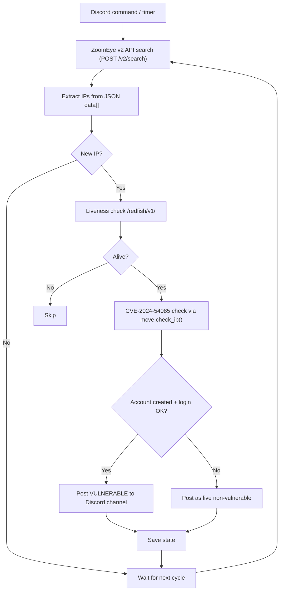

# MegaRAC Scraper Bot

> A Discord bot that hunts internet-exposed **AMI MegaRAC BMCs** via the ZoomEye API and automatically verifies them against **CVE-2024-54085**.

[](https://www.python.org/)
[](https://github.com/Rapptz/discord.py)
[](https://nvd.nist.gov/vuln/detail/CVE-2024-54085)
[](#license)

---

## What it does

1. **Scrapes** ZoomEye for MegaRAC management interfaces matching a dork.
2. **Filters** out IPs it has already seen.
3. **Checks liveness** on the Redfish endpoint.
4. **Verifies** each host against CVE-2024-54085 (account creation + login).
5. **Posts** live and vulnerable hosts straight to your Discord channel.
6. **Loops** on a schedule so you catch new hosts as they appear.

A host is only reported as **VULNERABLE** when it is *100% confirmed*: the exploit creates an admin account **and** that account successfully logs back in.

---

## How it works



---

## Requirements

- **Python 3.9+**
- A **Discord bot token** (see [setup](#discord-bot-setup))
- A **ZoomEye API key** — the free plan has *no* API access, so a paid key is required. Get one at <https://www.zoomeye.ai/profile>.

---

## Installation

```bash
git clone https://github.com/<your-user>/<your-repo>.git
cd <your-repo>
pip install -r requirements.txt
```

Create a `.env` file in the project root (see `.env.example`):

```env
# Discord
DISCORD_TOKEN=your_bot_token_here
DISCORD_CHANNEL_ID=123456789012345678

# ZoomEye v2 API
ZOOMEYE_API_KEY=your_zoomeye_api_key
ZOOMEYE_API_BASE=https://api.zoomeye.ai

# Scan settings
DORK=ssl.cert.issuer.cn="megarac.com" && app="lighttpd" && country!="CN" && port="443"
MAX_PAGES=3
PAGESIZE=100
VERIFY_WORKERS=150
SCAN_INTERVAL_MIN=30
BOT_PREFIX=!
```

Run it:

```bash
python bot.py
```

---

## Discord bot setup

1. Go to the [Discord Developer Portal](https://discord.com/developers/applications) and create a new application.
2. Open the **Bot** tab, create a bot, and copy the **token** into `DISCORD_TOKEN`.
3. Enable the **Message Content Intent** under *Privileged Gateway Intents*.
4. Invite the bot to your server using the OAuth2 URL generator (`bot` scope, with **Send Messages** permission).
5. Right-click your target channel → **Copy Channel ID** → paste into `DISCORD_CHANNEL_ID` (enable Developer Mode first).

---

## Commands

| Command | Description |
| --- | --- |
| `!scan` | Run a single scan cycle immediately |
| `!loop` | Start / stop the automatic periodic scan |
| `!status` | Show loop status, seen IP count, and hit count |
| `!vulns` | List every vulnerable host found so far |
| `!ips` | List every scraped IP |

---

## Configuration reference

| Variable | Default | Description |
| --- | --- | --- |
| `DISCORD_TOKEN` | — | Discord bot token (required) |
| `DISCORD_CHANNEL_ID` | — | Channel ID to post into (required) |
| `ZOOMEYE_API_KEY` | — | ZoomEye API key (required) |
| `ZOOMEYE_API_BASE` | `https://api.zoomeye.ai` | API base URL |
| `DORK` | MegaRAC dork | ZoomEye query string |
| `MAX_PAGES` | `3` | Pages of results to walk per cycle |
| `PAGESIZE` | `100` | Results per page (max 10,000) |
| `VERIFY_WORKERS` | `150` | Concurrent verification threads |
| `SCAN_INTERVAL_MIN` | `30` | Minutes between automatic scans |
| `BOT_PREFIX` | `!` | Command prefix |

---

## Project structure

```
.
├── bot.py            # Discord bot, scheduler, state, reporting
├── scraper.py        # ZoomEye v2 API client
├── mcve.py           # CVE-2024-54085 exploit + login verification
├── requirements.txt
├── .env.example
├── seen_ips.json     # generated: every IP already scraped
└── vulnerable.json   # generated: confirmed vulnerable hosts
```

---

## About CVE-2024-54085

**CVE-2024-54085** is an authentication bypass in **AMI MegaRAC SP-X** BMC firmware (CVSS 10.0). It lets an unauthenticated attacker create a local admin account through the Redfish `AccountService` API, and can lead to full BMC takeover — and from there, the host it manages.

The verification logic in `mcve.py` is deliberately strict so you never get false positives:

- **Stage 1** — `POST /redfish/v1/AccountService/Accounts` returns a `UserName` in the response.
- **Stage 2** — `POST /redfish/v1/SessionService/Sessions` with those credentials returns **HTTP 201**.

Both stages must pass before a host is reported.

---

## Notes

- **Rate limits** are per ZoomEye plan (Personal ~0.5 req/s). The scraper retries `429`s with backoff, but keep `MAX_PAGES` reasonable.
- `mcve.py` also runs **standalone** with its own terminal UI (`python mcve.py`) and writes confirmed hits to `megaracs.txt`.
- Standalone mode pushes to a hard-coded webhook in `CONFIG['WEBHOOK_URL']`. Blank it out if you only want Discord-channel output when running through the bot.

---

## Credits

- Exploit / verification logic — **Hiro.null\***
- ZoomEye API — [zoomeye.ai](https://www.zoomeye.ai/)

---

## License

MIT
